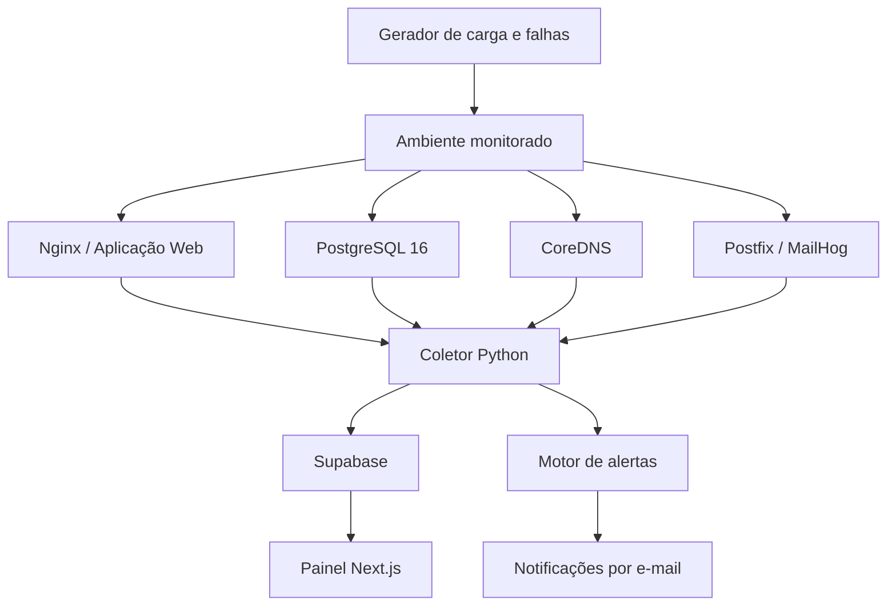

<div align="center">

# ⚡ DevOps Monitor

### Plataforma de Monitoramento, Observabilidade e Segurança de Infraestrutura

**Monitoramento inteligente de serviços Web, Banco de Dados, DNS e SMTP em uma única plataforma.**

<br/>


<br/>

**Projeto acadêmico — Engenharia de Software | IDP**

</div>

---

## 📌 Sobre o projeto

O **DevOps Monitor** é uma plataforma de monitoramento e observabilidade desenvolvida para acompanhar a disponibilidade, o desempenho e a segurança de diferentes serviços de uma infraestrutura.

A solução reúne informações de quatro componentes fundamentais:

- 🌐 **Web:** disponibilidade, requisições por segundo, latência e erros HTTP.
- 🗄️ **Database:** conexões, consultas, transações, utilização de recursos e crescimento do banco.
- 🌍 **DNS:** tempo de resolução, falhas de consulta e volume de requisições.
- ✉️ **SMTP:** tamanho da fila, entregas, rejeições e latência de envio de mensagens.

Os dados são coletados por um serviço Python, armazenados no Supabase e disponibilizados em um painel desenvolvido com Next.js.

Além do monitoramento convencional, o projeto possui mecanismos de detecção de anomalias, tentativas de força bruta, alterações de configuração e vulnerabilidades conhecidas.

O objetivo é transformar diferentes informações operacionais em uma visão centralizada, facilitando a identificação de problemas e o acompanhamento da infraestrutura.

---

## 🎯 Objetivos

- Centralizar o monitoramento de diferentes serviços.
- Identificar indisponibilidades e degradações de desempenho.
- Acompanhar métricas operacionais e históricas.
- Detectar comportamentos potencialmente maliciosos.
- Automatizar a geração e o envio de alertas.
- Disponibilizar informações por meio de uma interface intuitiva.
- Simular situações reais de falhas e incidentes para testar a plataforma.

---

## 🏗️ Arquitetura

O projeto utiliza uma arquitetura dividida em componentes independentes, permitindo separar o ambiente monitorado, a coleta de informações, o armazenamento e a visualização dos dados.



### Fluxo de funcionamento

1. Os serviços são inicializados em um ambiente controlado com Docker Compose.
2. O coletor Python executa sondas e obtém métricas dos serviços.
3. Os dados são processados e armazenados no Supabase.
4. O painel consulta as informações utilizando autenticação e políticas de acesso.
5. O mecanismo de alertas identifica condições críticas e registra os incidentes.
6. Os operadores acompanham os indicadores e os alertas pela interface web.

---

## 🚀 Funcionalidades

### 1. Monitoramento de serviços

| Serviço | Indicadores monitorados |
|---|---|
| Web | RPS, latência p50/p95, erros 4xx/5xx e conexões ativas |
| Database | QPS, conexões, transações, consultas lentas, CPU, memória e I/O |
| DNS | Tempo de resolução, taxa de falhas e volume de consultas |
| SMTP | Fila de mensagens, entregas, rejeições e latência de envio |

A coleta utiliza diferentes fontes, como logs estruturados, consultas SQL, sondas de protocolo e informações disponibilizadas pelos próprios serviços.

### 2. Dashboard de monitoramento

O painel web foi desenvolvido para centralizar as informações da infraestrutura.

Entre os recursos implementados estão:

- Autenticação de operadores.
- Proteção de rotas por sessão.
- Visão geral dos quatro serviços monitorados.
- Indicadores de disponibilidade.
- Histórico de alertas.
- Atualizações em tempo real utilizando Supabase Realtime.
- Páginas de acompanhamento por serviço.
- Interface responsiva.

O sistema diferencia dados indisponíveis de valores efetivamente medidos, evitando apresentar informações fictícias como indicadores reais.

### 3. Sistema de alertas

O projeto possui um mecanismo de avaliação de condições operacionais.

O motor de alertas utiliza regras configuráveis, níveis de severidade e histerese para evitar mudanças excessivas de estado.

Os alertas são classificados em:

- 🟢 **Verde:** condição normal.
- 🟡 **Amarelo:** atenção necessária.
- 🔴 **Vermelho:** condição crítica.

Também existe suporte para notificações por e-mail, com controle de intervalos de reenvio e mensagens de resolução.

### 4. Detecção de anomalias e segurança

O DevOps Monitor também contempla mecanismos voltados à identificação de comportamentos suspeitos.

| Mecanismo | Descrição |
|---|---|
| Anomalias de tráfego | Identificação de variações incomuns no volume de requisições utilizando análise estatística e Z-Score. |
| Brute Force | Identificação de tentativas repetidas de autenticação por endereço IP e conta. |
| Config Watch | Monitoramento de alterações nos arquivos de configuração dos serviços utilizando hashes SHA-256. |
| CVE Scanner | Consulta à base do NVD para identificar vulnerabilidades associadas às versões dos serviços monitorados. |

### 5. Gerador de carga e falhas

Para possibilitar demonstrações e testes controlados, o projeto inclui um gerador de cenários desenvolvido em Python.

Cenários disponíveis:

- `normal`: geração de tráfego convencional.
- `spike`: simulação de aumento repentino de requisições.
- `bruteforce`: simulação de tentativas repetidas de autenticação.
- `stop_service`: interrupção controlada de um serviço.
- `edit_config`: alteração temporária de configuração.
- `smtp_flood`: envio controlado de mensagens para o ambiente SMTP local.

Os cenários potencialmente disruptivos exigem confirmação explícita e foram projetados para utilização no laboratório isolado do projeto.

---

## 🛠️ Tecnologias utilizadas

### Backend e coleta

| Tecnologia | Aplicação |
|---|---|
| Python 3.12 | Desenvolvimento do coletor e ferramentas auxiliares |
| APScheduler | Agendamento dos ciclos de coleta |
| Pydantic | Configuração e validação de dados |
| Psycopg 3 | Comunicação com PostgreSQL |
| dnspython | Consultas e monitoramento DNS |
| icmplib | Verificações de disponibilidade via ICMP |
| Docker SDK | Coleta controlada de informações dos containers |

### Frontend

| Tecnologia | Aplicação |
|---|---|
| Next.js 15 | Framework da aplicação web |
| React 19 | Construção da interface |
| TypeScript | Tipagem estática |
| Tailwind CSS 4 | Estilização |
| Supabase SSR | Autenticação e gerenciamento de sessões |
| Vitest | Testes unitários |
| Playwright | Testes end-to-end |

### Infraestrutura e armazenamento

- Docker e Docker Compose.
- Nginx.
- PostgreSQL 16.
- CoreDNS.
- Postfix.
- MailHog.
- Supabase (PostgreSQL, Auth e Realtime).
- API do NVD para consulta de vulnerabilidades.

---

## 📂 Estrutura do projeto

```text
DevOps-Monitor/
│
├── collector/                  # Coletor Python
│   ├── src/
│   │   └── monitor/
│   │       ├── probes/         # Sondas de monitoramento
│   │       ├── alerts/         # Motor e notificações
│   │       ├── security/       # Detectores de segurança
│   │       ├── main.py
│   │       ├── config.py
│   │       ├── model.py
│   │       ├── store.py
│   │       └── calc.py
│   ├── tests/                  # Testes do coletor
│   └── pyproject.toml
│
├── frontend/                  # Protótipo visual anterior
│
├── web/                       # Aplicação Next.js
│   ├── app/
│   │   ├── login/
│   │   └── (dash)/
│   ├── components/
│   ├── lib/
│   │   └── supabase/
│   ├── e2e/
│   └── package.json
│
├── infra/                     # Configuração dos serviços
│   ├── nginx/
│   ├── demo-app/
│   ├── postgres/
│   ├── coredns/
│   ├── postfix/
│   └── docker_stats_proxy/
│
├── loadgen/                   # Gerador de carga e falhas
│   ├── scenarios/
│   └── tests/
│
├── supabase/                  # Banco, migrations e seeds
│   ├── migrations/
│   ├── config.toml
│   └── seed.sql
│
├── docs/                      # Documentação técnica
│   ├── sdd/
│   ├── runbooks/
│   ├── playbooks/
│   └── instalacao.md
│
├── docker-compose.yml
├── .env.example
├── .gitignore
└── README.md
```

---

## ⚙️ Instalação e execução

### Pré-requisitos

- Docker Engine.
- Docker Compose v2.
- Python 3.12.
- `uv`.
- Node.js 22 ou superior.
- pnpm 11 ou superior.
- Projeto Supabase configurado.

### 1. Clonar o repositório

```bash
git clone https://github.com/Matheus-Nunes223/DevOps-Monitor.git

cd DevOps-Monitor
```

### 2. Configurar as variáveis de ambiente

Na raiz do projeto:

```bash
cp .env.example .env
```

Configure as variáveis necessárias para o coletor, incluindo a conexão com o Supabase.

Para o painel, configure também:

```bash
cd web

cp .env.example .env.local
```

Preencha `NEXT_PUBLIC_SUPABASE_URL` e `NEXT_PUBLIC_SUPABASE_PUBLISHABLE_KEY` (ou a chave anon legada).

**Importante:** nunca exponha a chave `SUPABASE_SERVICE_ROLE_KEY` no frontend ou em variáveis `NEXT_PUBLIC_*`.

### 3. Inicializar o ambiente Docker

Na raiz do projeto:

```bash
docker compose up --build -d
```

Verifique os serviços:

```bash
docker compose ps
```

### 4. Executar o painel web

```bash
cd web

pnpm install --frozen-lockfile

pnpm dev
```

Acesse:

```text
http://localhost:3000
```

A autenticação real depende da configuração do projeto Supabase e da criação de um usuário de operador.

### 5. Executar o coletor localmente

Com Python 3.12 e `uv` instalados:

```bash
cd collector

uv sync --dev

uv run pytest

uv run devops-monitor
```

A execução integrada requer o laboratório Docker ativo e as conexões de banco configuradas.

### 6. Executar o gerador de carga

Exemplo:

```bash
uv run --project loadgen devops-loadgen normal --requests 60 --rate 2
```

Para consultar os cenários disponíveis:

```bash
uv run --project loadgen devops-loadgen --help
```

Consulte `loadgen/README.md` antes de executar cenários que alteram ou interrompem serviços.

---

## 🧪 Testes e validação

O projeto possui testes em diferentes camadas:

| Camada | Ferramenta | Objetivo |
|---|---|---|
| Coletor | Pytest | Validar cálculos, sondas, parsers e regras |
| Gerador de carga | Pytest | Validar cenários e limites de execução |
| Frontend | Vitest | Validar componentes e comportamentos |
| Interface | Playwright | Verificar navegação, responsividade e fluxos E2E |
| Qualidade | ESLint e TypeScript | Verificar padrões e tipagem do frontend |
| Build | Next.js | Validar a compilação de produção |

**Estado de validação:** foram reportados testes unitários aprovados no coletor e no gerador de carga, além de 12 testes unitários e 6 testes E2E aprovados no painel. O lint, a verificação de tipos e o build de produção do frontend também foram aprovados.

A validação integrada com Docker, Supabase real, autenticação externa e publicação em produção depende da configuração desses ambientes. Portanto, os resultados dos testes automatizados não devem ser confundidos com uma homologação completa da infraestrutura.

---

## 🔐 Segurança

A segurança faz parte da arquitetura do projeto.

Entre as medidas adotadas estão:

- Separação entre credenciais públicas e privadas.
- Proteção de rotas do painel por autenticação.
- Utilização de políticas de Row Level Security (RLS).
- Restrição das portas publicadas ao loopback quando aplicável.
- Proxy dedicado para limitar o acesso à API Docker.
- Montagem de arquivos monitorados em modo somente leitura.
- Limites de execução nos cenários de carga e falha.
- Validação das chaves públicas para impedir exposição acidental de credenciais privilegiadas.

O projeto foi concebido para demonstração em ambiente controlado, não devendo ser considerado uma solução pronta para monitorar infraestruturas de produção sem uma revisão adicional de segurança e configuração.

---

## 📚 Documentação

A documentação técnica complementar está disponível no diretório `docs/`.

| Documento | Conteúdo |
|---|---|
| `docs/instalacao.md` | Instalação e configuração do ambiente |
| `docs/sdd/` | Especificações, arquitetura e planejamento técnico |
| `docs/runbooks/` | Procedimentos operacionais por serviço |
| `docs/playbooks/` | Procedimentos de resposta a incidentes |
| `collector/README.md` | Configuração e execução do coletor |
| `web/README.md` | Configuração e execução do painel |
| `loadgen/README.md` | Cenários de carga e falhas |

---

## 👥 Equipe de desenvolvimento

Projeto desenvolvido por:

<table align="center">
  <tr>
    <td align="center">
      <strong>Matheus Nunes</strong><br/>
      Desenvolvimento
    </td>
    <td align="center">
      <strong>João Guilherme</strong><br/>
      Desenvolvimento
    </td>
    <td align="center">
      <strong>Bruna Cayres</strong><br/>
      Desenvolvimento
    </td>
  </tr>
</table>

**Instituição:** Instituto Brasileiro de Ensino, Desenvolvimento e Pesquisa (IDP)  
**Curso:** Engenharia de Software  
**Projeto acadêmico:** Redes de Computadores e Internet

---

<div align="center">

### DevOps Monitor

**Monitoramento, observabilidade e segurança em um único ambiente.**

Desenvolvido como projeto acadêmico, com foco na aplicação prática de conceitos de infraestrutura, desenvolvimento de software, redes e segurança da informação.

</div>
