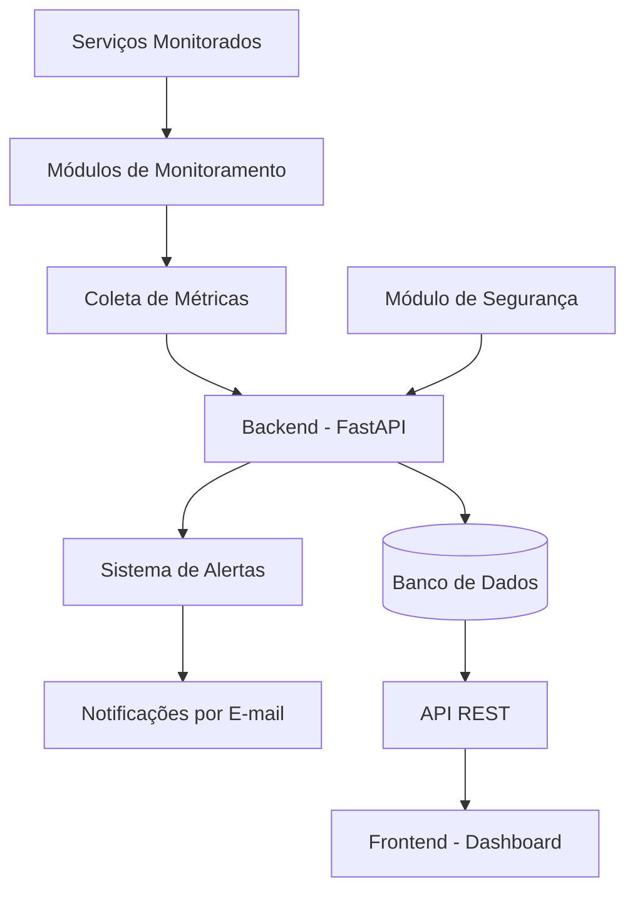

# ◈ DevOps Monitor

### MONITOR YOUR INFRASTRUCTURE. UNDERSTAND EVERY SIGNAL.

**Uma plataforma inteligente para monitoramento, observabilidade e segurança de serviços de rede.**

Centralizando métricas, identificando anomalias e transformando dados operacionais em informações estratégicas.

<p align="left">
  
  
  
  
  
</p>

[Visão geral](#-visão-geral) • [Funcionalidades](#-funcionalidades) • [Tecnologias](#-tecnologias) • [Arquitetura](#-arquitetura) • [Instalação](#-instalação) • [Roadmap](#-roadmap)

---

## ◈ Visão geral

O **DevOps Monitor** é uma plataforma web desenvolvida para centralizar o monitoramento de serviços de rede, permitindo acompanhar disponibilidade, desempenho, métricas operacionais e indicadores de segurança por meio de dashboards interativos.

A proposta é oferecer uma visão consolidada da infraestrutura monitorada, facilitando a identificação de falhas, degradações de desempenho e comportamentos potencialmente suspeitos.

A plataforma contará com módulos independentes de monitoramento, responsáveis por verificar periodicamente os serviços cadastrados, coletar métricas e encaminhar os resultados para processamento e armazenamento.

Além disso, o sistema terá mecanismos de classificação de alertas e envio de notificações automáticas por e-mail, permitindo que situações críticas sejam identificadas e acompanhadas de maneira centralizada.

> **Monitoramento inteligente. Infraestrutura confiável.**

## 🎯 Objetivos do projeto

- Desenvolver uma plataforma centralizada para monitoramento de serviços de rede.
- Implementar dashboards interativos para visualização de métricas operacionais.
- Monitorar disponibilidade e desempenho de diferentes serviços.
- Implementar mecanismos de identificação e classificação de alertas.
- Desenvolver notificações automáticas por e-mail.
- Incorporar recursos adicionais de monitoramento de segurança.
- Organizar a aplicação em módulos independentes e de fácil manutenção.
- Aplicar conceitos de redes de computadores, desenvolvimento web, observabilidade e DevOps.

---

## ✨ Funcionalidades

As funcionalidades estão organizadas em módulos para facilitar o desenvolvimento e a evolução da plataforma.

### 📊 Monitoramento de serviços

A plataforma será responsável por acompanhar o funcionamento de diferentes serviços de rede, apresentando indicadores relevantes para cada categoria.

| Serviço | Indicadores monitorados |
|---|---|
| 🌐 **HTTP/HTTPS** | Disponibilidade, latência, requisições e erros |
| 🗄️ **Database** | Disponibilidade, conexões, consultas e desempenho |
| 🌍 **DNS** | Tempo de resolução, consultas e falhas |
| ✉️ **SMTP** | Disponibilidade, latência e erros de comunicação |

### 📈 Dashboards interativos

A interface permitirá acompanhar as informações coletadas por meio de painéis individuais e de uma visão consolidada da infraestrutura.

Entre os recursos previstos estão:

- Dashboard geral com indicadores de todos os serviços.
- Painéis individuais para cada serviço monitorado.
- Gráficos de desempenho e histórico de métricas.
- Indicadores de disponibilidade e estado operacional.
- Tabelas com eventos e informações relevantes.
- Atualização periódica das informações.

### 🚨 Sistema de alertas

O sistema utilizará três níveis de classificação para representar as condições operacionais dos serviços.

| Nível | Estado | Descrição |
|---|---|---|
| 🟢 | **Normal** | Serviço operando dentro dos parâmetros esperados. |
| 🟡 | **Atenção** | Identificação de degradação ou comportamento anormal. |
| 🔴 | **Crítico** | Serviço indisponível ou condição crítica identificada. |

Os alertas poderão gerar notificações automáticas por e-mail, de acordo com a gravidade do incidente.

### 🔐 Monitoramento de segurança

O módulo de segurança pretende ampliar a capacidade de observação da infraestrutura por meio da identificação de eventos potencialmente suspeitos.

Funcionalidades previstas:

- Identificação de anomalias no tráfego de rede.
- Monitoramento de tentativas de autenticação malsucedidas.
- Identificação de possíveis ataques de força bruta.
- Detecção de alterações em arquivos de configuração.
- Monitoramento de vulnerabilidades conhecidas.
- Identificação de padrões de tráfego potencialmente associados a ataques de negação de serviço (DDoS).

### ⚙️ Configurações

A plataforma contará com uma área para gerenciamento dos parâmetros de monitoramento, incluindo configurações de serviços, atualização de métricas e preferências de alertas.

---

## 🛠️ Tecnologias

O projeto utiliza tecnologias voltadas ao desenvolvimento de aplicações web, processamento de dados e monitoramento de infraestrutura.

### Backend

<p>
  
</p>

- **Python:** linguagem principal para implementação dos módulos de monitoramento e processamento.
- **FastAPI:** desenvolvimento da API REST e comunicação entre os componentes.
- **SQLite:** armazenamento inicial de métricas, eventos e informações operacionais.
- **Pytest:** desenvolvimento de testes automatizados.

### Frontend

<p>
  
</p>

- **HTML5:** estrutura das páginas e componentes da interface.
- **CSS3:** identidade visual, estilização e responsividade.
- **JavaScript:** interatividade e integração com o backend.
- **Chart.js:** construção de gráficos e visualizações de métricas.

### Desenvolvimento e versionamento

<p>
  
</p>

- **Git:** controle de versão e gerenciamento de alterações.
- **GitHub:** hospedagem do código e colaboração.
- **Visual Studio Code:** ambiente de desenvolvimento.

### Papel de cada tecnologia

| Tecnologia | Aplicação no projeto |
|---|---|
| **Python** | Implementação dos módulos de monitoramento e processamento. |
| **FastAPI** | Criação da API REST e integração entre os componentes. |
| **SQLite** | Persistência inicial de métricas e eventos. |
| **Pytest** | Testes unitários e de integração. |
| **HTML5** | Estrutura da interface web. |
| **CSS3** | Estilização e responsividade. |
| **JavaScript** | Interatividade e comunicação com a API. |
| **Chart.js** | Visualização gráfica das métricas. |
| **Git e GitHub** | Controle de versão e gerenciamento do projeto. |

---

## 🏗️ Arquitetura

A aplicação será organizada em módulos independentes, responsáveis pela coleta, processamento, armazenamento, análise e visualização das informações.

O objetivo dessa organização é separar as responsabilidades de cada componente, facilitando a manutenção e permitindo que novos serviços sejam adicionados futuramente.

### Diagrama da arquitetura



*Diagrama conceitual da arquitetura planejada. A implementação dos componentes será realizada de maneira incremental.*

### Fluxo de funcionamento

1. Os módulos de monitoramento verificam periodicamente os serviços cadastrados.
2. As métricas coletadas são encaminhadas ao backend.
3. O backend processa e organiza as informações recebidas.
4. Os resultados são armazenados no banco de dados.
5. O sistema de alertas avalia as métricas e identifica possíveis incidentes.
6. Notificações são encaminhadas por e-mail conforme a classificação dos alertas.
7. O frontend consulta a API e apresenta as informações em dashboards interativos.

A arquitetura também permitirá que o módulo de segurança encaminhe eventos identificados para o backend, possibilitando a centralização das informações operacionais e de segurança.

---

## 📂 Estrutura do projeto

A organização do repositório foi planejada para separar os principais componentes da aplicação.

```text
DevOps-Monitor/
│
├── backend/
│   └── app/
│       ├── api/
│       │   └── endpoints/
│       ├── core/
│       ├── models/
│       ├── schemas/
│       └── services/
│
├── frontend/
│   ├── assets/
│   │   └── images/
│   ├── css/
│   │   ├── style.css
│   │   └── dashboard.css
│   ├── js/
│   │   ├── app.js
│   │   ├── dashboard.js
│   │   ├── charts.js
│   │   └── api.js
│   └── index.html
│
├── monitoramento/
│   ├── web/
│   ├── database/
│   ├── dns/
│   ├── smtp/
│   └── utils/
│
├── alertas/
│
├── seguranca/
│
├── testes/
│
├── docs/
│
├── dados/
│
├── .env.example
├── .gitignore
├── README.md
└── requirements.txt
```

*Estrutura de referência da arquitetura planejada. Os diretórios e módulos serão preenchidos conforme as etapas de implementação forem concluídas.*

---

## 🚀 Instalação

### Pré-requisitos

Antes de iniciar, verifique se o ambiente possui:

- Python 3.10 ou superior.
- Git instalado.
- Visual Studio Code ou outro editor de sua preferência.

### 1. Clone o repositório

```bash
git clone https://github.com/Matheus-Nunes223/DevOps-Monitor.git
```

### 2. Entre na pasta do projeto

```bash
cd DevOps-Monitor
```

### 3. Crie um ambiente virtual

No Linux:

```bash
python3 -m venv .venv
```

### 4. Ative o ambiente virtual

```bash
source .venv/bin/activate
```

### 5. Instale as dependências

```bash
python -m pip install -r requirements.txt
```

### 6. Execute o frontend

Atualmente, o frontend possui dados demonstrativos para permitir a navegação e visualização dos dashboards enquanto o backend está em desenvolvimento.

Para executá-lo localmente:

```bash
python3 -m http.server 8000 --directory frontend
```

Acesse a aplicação pelo navegador:

```text
http://localhost:8000
```

> **Nota:** a interface já possui estrutura de integração preparada para a futura API. Os dados apresentados no modo demonstrativo não representam métricas coletadas de serviços reais. A execução completa da plataforma dependerá da implementação e integração dos módulos de backend, monitoramento, armazenamento e alertas.

---

## 🗺️ Roadmap

O desenvolvimento será dividido em etapas para permitir a implementação e validação progressiva dos componentes.

### Estrutura e interface

- [x] Criar o repositório no GitHub.
- [x] Definir a arquitetura inicial do projeto.
- [x] Configurar a estrutura inicial de diretórios.
- [x] Desenvolver a interface principal da plataforma.
- [x] Implementar os dashboards demonstrativos.
- [x] Implementar a navegação entre as áreas da aplicação.
- [x] Preparar a estrutura de integração com a API.

### Backend e persistência

- [ ] Implementar a estrutura do backend com FastAPI.
- [ ] Configurar o banco de dados.
- [ ] Desenvolver os modelos de dados.
- [ ] Implementar os endpoints da API REST.
- [ ] Integrar frontend e backend.

### Monitoramento

- [ ] Implementar monitoramento HTTP/HTTPS.
- [ ] Implementar monitoramento de bancos de dados.
- [ ] Implementar monitoramento DNS.
- [ ] Implementar monitoramento SMTP.
- [ ] Desenvolver a coleta periódica de métricas.
- [ ] Implementar armazenamento de dados históricos.

### Alertas e segurança

- [ ] Implementar a classificação de alertas.
- [ ] Desenvolver o sistema de notificações por e-mail.
- [ ] Implementar identificação de anomalias de tráfego.
- [ ] Desenvolver monitoramento de falhas de autenticação.
- [ ] Implementar detecção de alterações em configurações.
- [ ] Incorporar monitoramento de vulnerabilidades conhecidas.

### Validação e documentação

- [ ] Desenvolver testes automatizados.
- [ ] Realizar testes de integração.
- [ ] Documentar a arquitetura da aplicação.
- [ ] Elaborar guias de instalação e configuração.
- [ ] Desenvolver runbooks e playbooks de incidentes.
- [ ] Realizar validação geral da plataforma.
- [ ] Preparar a apresentação final.

*O roadmap será atualizado conforme o desenvolvimento avançar.*

---

## 🧪 Testes e validação

A aplicação contará com testes automatizados para verificar o funcionamento dos diferentes componentes.

A validação deverá considerar:

- Funcionamento dos módulos de monitoramento.
- Disponibilidade e tempo de resposta dos serviços.
- Processamento e armazenamento de métricas.
- Comunicação entre frontend e backend.
- Funcionamento dos endpoints da API.
- Classificação e geração de alertas.
- Envio de notificações por e-mail.
- Identificação de eventos de segurança.

Os testes serão desenvolvidos utilizando **Pytest**, contemplando testes unitários e de integração.

---

## 📚 Documentação

A documentação técnica será organizada no diretório `docs/`, contemplando os materiais necessários para instalação, operação e manutenção da plataforma.

Entre os documentos previstos estão:

- **Arquitetura:** descrição dos componentes e da comunicação entre os módulos.
- **Instalação:** instruções para configuração e execução da aplicação.
- **Runbooks:** procedimentos operacionais para acompanhamento e resolução de problemas.
- **Playbooks:** orientações para identificação e resposta a incidentes.
- **Monitoramento:** documentação dos serviços, métricas e parâmetros utilizados.

---

## 🎓 Contexto acadêmico

O DevOps Monitor é um projeto acadêmico desenvolvido como parte do trabalho final da disciplina **Redes de Computadores e Internet**, do Instituto Brasileiro de Ensino, Desenvolvimento e Pesquisa (IDP).

**Instituição:** Instituto Brasileiro de Ensino, Desenvolvimento e Pesquisa — IDP  
**Disciplina:** Redes de Computadores e Internet  
**Professora:** Lorena Borges  
**Projeto:** Trabalho Final — Plataforma de Monitoramento para DevOps

O desenvolvimento busca aplicar conhecimentos relacionados a:

- Redes de computadores e protocolos de comunicação.
- Desenvolvimento de aplicações web.
- Monitoramento de infraestrutura.
- Segurança de redes.
- Armazenamento e análise de métricas.
- Observabilidade e práticas DevOps.

---

## 👨‍💻 Desenvolvedor

**Matheus Nunes**

Estudante de Engenharia de Software, interessado em desenvolvimento de software, análise de dados, infraestrutura e segurança da informação.

[](https://github.com/Matheus-Nunes223)

---

### ◈ DevOps Monitor

**MONITORAMENTO INTELIGENTE. INFRAESTRUTURA CONFIÁVEL.**

*Transformando métricas em visibilidade. Visibilidade em decisões.*
