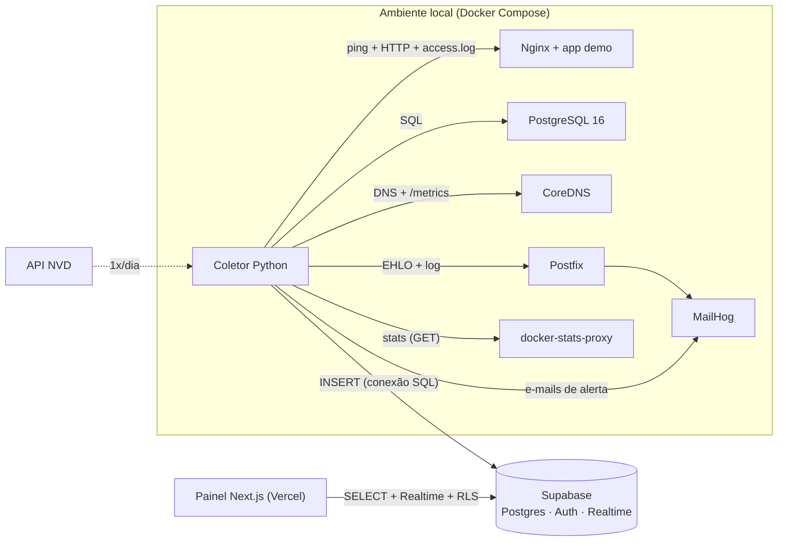

# Arquitetura

## Componentes
| Camada | Papel |
|---|---|
| `infra/` | Serviços monitorados: Nginx + app demo, PostgreSQL, CoreDNS, Postfix/MailHog |
| `collector/` | Sondas a cada 15 s, motor de alertas (histerese de 2 ciclos), e-mail, detectores de segurança, job diário de CVE |
| `supabase/` | Esquema, RLS, funções (`metric_series`, `service_availability_24h`, `accept_config_baseline`), retenção de 7 dias |
| `web/` | Painel: visão consolidada, dashboards por serviço, segurança; login por e-mail/senha |
| `loadgen/` | Cenários de carga e falha para a demonstração |

## Ciclo do coletor
1. Sondas rodam em paralelo (timeout de 8 s cada); falha de uma sonda não afeta as outras.
2. Métricas e estados são gravados em lote no Supabase.
3. Detectores de segurança leem o `access.log` e comparam hashes de configuração.
4. O motor de alertas avalia as regras, abre/fecha alertas, atualiza `services.current_level` e envia e-mails (Vermelho: reenvio a cada 10 min; Amarelo: a cada 30 min; e-mail de resolução ao voltar a Verde).
5. O painel recebe mudanças via Realtime.

## Decisões de projeto
- **Coletor fora da Vercel:** funções serverless não rodam continuamente, não fazem ICMP e não alcançam a rede Docker.
- **Segurança de acesso:** só o coletor escreve (conexão SQL privada); o painel usa apenas a chave pública + sessão e RLS. Única escrita do painel: `accept_config_baseline`, função `security definer` com lista de arquivos permitidos.
- **Socket do Docker:** o coletor não o recebe; um proxy isolado só repassa `GET stats` do container do banco.
- **Canal de alerta independente:** e-mails não passam pelo Postfix monitorado.
- **`<svc>.up`:** valor = verificações de protocolo falhas consecutivas (Amarelo 1, Vermelho 2); por isso não há histerese adicional.
- **Segurança sem histerese:** DDoS, brute-force e mudança de configuração abrem alerta no ciclo em que são detectados; resolvem após 4 (DDoS), 2 (brute-force) e 1 (configuração) ciclos sem a condição.
- **Estado do serviço** = pior nível entre suas regras e seus alertas de segurança/CVE abertos.
